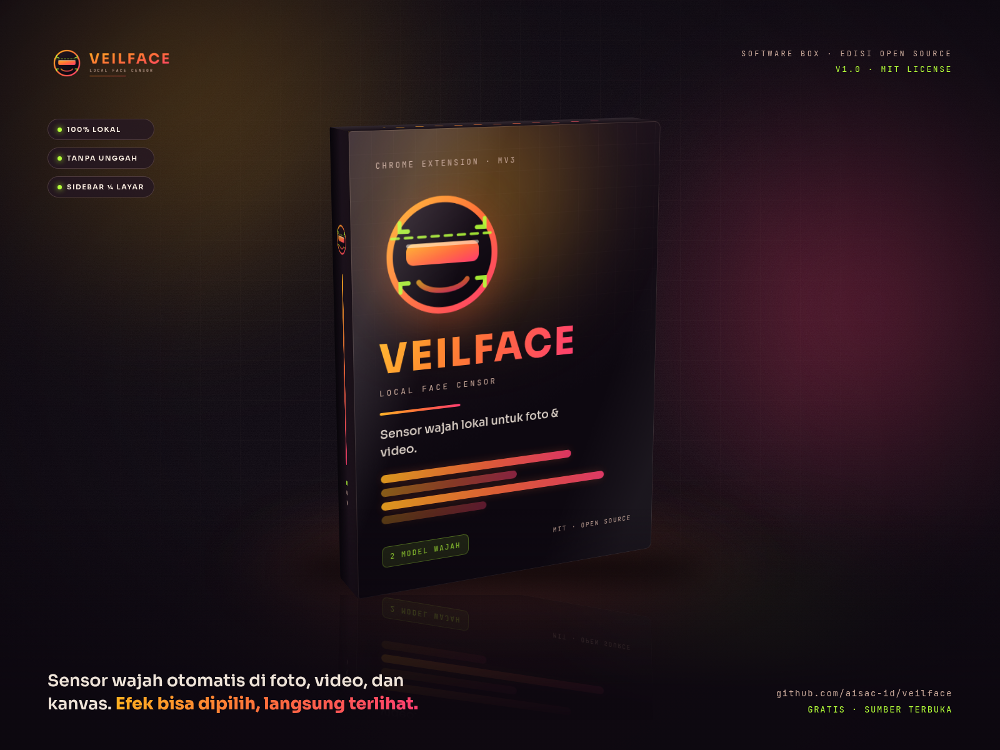
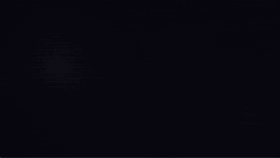

# VeilFace

**Sensor wajah otomatis di foto, video, dan kanvas pada halaman web mana pun — 100% lokal, dikendalikan dari sidebar 1/4 layar dengan tab tersusun ke bawah.**

VeilFace mendeteksi wajah langsung di dalam tab menggunakan model yang dibundel bersama ekstensi, lalu menutupinya dengan efek pilihanmu: censor bar, eye strip, blur, mozaik, RGB glitch, emoji mask, hologram, thermal, dan lainnya. Tidak ada gambar, wajah, atau embedding yang dikirim ke server mana pun.

Proyek saudaranya, **[VeilKit](https://github.com/aisac-id/veilkit)**, melakukan hal yang sama untuk data pribadi berbasis teks.

---

## Kenapa VeilFace

- **Sidebar 1/4 layar, tab vertikal.** Panel selebar 25% layar (bisa diatur 18–50%), halaman digeser agar tidak tertutupi. Delapan tab disusun ke bawah: Status, Deteksi, Efek Wajah, Parameter, Media, Situs & Area, Ekspor, Pengaturan.
- **Deteksi wajah lokal.** Tiny Face Detector (190 KB, cepat) atau SSD MobileNet v1 (5,4 MB, akurat). Bobot model dimuat dari paket ekstensi lewat service worker, jadi tidak ada masalah CORS dan tidak ada unduhan runtime.
- **Foto, video, dan kanvas.** Gambar diam dipindai sekali pada resolusi tinggi; frame video dipindai berkala dengan pelacakan IoU, tenggang 700 ms, dan penghalusan gerak agar sensor tidak berkedip.
- **14 efek wajah** dengan pratinjau hidup di sidebar dan 12 slider parameter yang berlaku seketika.
- **Kontrol per media.** Setiap gambar/video/kanvas bisa punya efek sendiri, dimatikan sendiri, diintip sementara, difokuskan di halaman, atau diekspor sebagai PNG tersensor pada resolusi aslinya.
- **Aksi massal.** Pilih semua media, terapkan satu efek, nyalakan/matikan sensor, reset override — dengan pencarian, filter jenis, dan empat mode urutan.
- **Panic & intip.** Satu tombol menutup seluruh media dengan balok solid; satu tombol lain membuka semua sensor sementara untuk memeriksa hasil.
- **Gagal = tertutup.** Kalau deteksi gagal atau media lintas-origin tidak bisa dibaca, seluruh media ditutup penuh. Tidak ada wajah yang lolos karena error.
- **Ekspor & laporan.** PNG tersensor, konfigurasi JSON, CSV inventaris media, dan laporan Markdown.

## Efek wajah

| Efek | Keterangan |
| --- | --- |
| Censor Bar | Balok solid menutupi seluruh wajah |
| Eye Strip | Pita hitam di area mata saja |
| Gaussian Blur | Wajah dilarutkan dengan blur halus |
| Mozaik | Kotak piksel besar ala sensor berita |
| RGB Glitch | Kanal warna pecah dan irisan bergeser (animasi) |
| Emoji Mask | Wajah diganti emoji pilihanmu |
| Void Swirl | Lubang gelap berputar menelan wajah (animasi) |
| Hologram | Kisi holografik dengan scanline (animasi) |
| Thermal | Peta panas menggantikan detail wajah |
| Static Noise | Semen statis TV di area wajah (animasi) |
| Hypno Spiral | Pola spiral berputar (animasi) |
| Geo Avatar | Topeng geometris identitas anonim |
| Glyph Scramble | Kisi karakter acak di atas wajah (animasi) |
| Outline Saja | Hanya menandai wajah, tanpa sensor |

## Pasang (Load unpacked)

1. Unduh atau `git clone` repositori ini.
2. Buka `chrome://extensions` di Chrome (atau Edge/Brave/Chromium lain).
3. Aktifkan **Developer mode** di kanan atas.
4. Klik **Load unpacked**, pilih folder repositori ini (folder yang berisi `manifest.json`).
5. Buka halaman berisi foto/video, tekan **Alt+Shift+F** atau klik ikon VeilFace di toolbar.

### Pintasan

| Tombol | Aksi |
| --- | --- |
| `Alt+Shift+F` | Buka/tutup sidebar |
| `Alt+Shift+R` | Pindai ulang semua media |
| Klik kanan gambar | Menu konteks: sensor wajah pada gambar ini, pindai ulang, buka sidebar |

## Coba tanpa memasang

```bash
python3 -m http.server 8080
# lalu buka http://localhost:8080/demo/index.html
```

Halaman demo "Arsip Nusa" memuat foto tim enam orang, foto rapat, potret tunggal, klip video, kanvas yang bergerak, dan satu gambar lintas-origin — semuanya dibuat untuk demonstrasi. Tombol di halaman demo bisa menambah foto secara dinamis, mengganti sumber foto, dan menghapus tambahan untuk menguji pemindaian ulang.

## Privasi

- Inferensi berjalan sepenuhnya di dalam tab. Tidak ada unggahan, telemetri, atau analitik.
- Bobot model dibaca dari paket ekstensi melalui service worker (`chrome.runtime.getURL`), bukan dari CDN.
- Gambar lintas-origin diambil ulang oleh service worker agar kanvas tidak *tainted*; hasilnya tetap berada di perangkat.
- Preferensi disimpan di `chrome.storage.local`. Tidak ada nilai wajah, landmark, atau embedding yang disimpan.
- Sidebar berjalan di iframe ber-origin ekstensi dengan `postMessage` bertoken acak per sesi.

## Performa

- Satu kanvas overlay menutupi viewport, digambar dalam satu loop `requestAnimationFrame` dengan batas FPS dan batas device-pixel-ratio sesuai mode kualitas (Hemat 1×, Seimbang 1,5×, Tajam 2×).
- Pemindaian dipicu `IntersectionObserver`: media di luar layar tidak menghabiskan CPU.
- Gambar diam dipindai pada resolusi deteksi penuh; video dibatasi maksimal 416 px agar frame tetap responsif.
- Di perangkat tanpa GPU, backend jatuh ke CPU. Turunkan **Resolusi deteksi** dan **Batas FPS**, atau pilih mode **Hemat**, bila halaman terasa berat.

## Arsitektur

```
manifest.json        Manifest V3
background.js        Service worker: pengaturan, badge, relay model & gambar
src/engine.js        Registry media, deteksi, pelacakan, overlay, ekspor PNG
src/effects.js       14 efek wajah pada kanvas
src/content.js       Jembatan sidebar ↔ mesin, dock halaman, pintasan
src/sidebar.js       Delapan tab vertikal, seluruh kontrol live
src/audio.js         Efek suara sintetis WebAudio
src/page.css         Overlay, dock halaman, scrollbar bertema
src/sidebar.css      Bahasa visual sidebar
sidebar.html         Kerangka sidebar
models/              Bobot Tiny Face Detector, SSD MobileNet v1, landmark 68
vendor/face-api.min.js
demo/                Halaman uji + aset foto/video
```

Alur pemuatan model: sidebar → content script → service worker membaca berkas model dari paket ekstensi → base64 → content script menggabungkan shard sesuai urutan manifest → `tf.io.decodeWeights` → `net.loadFromWeightMap`. Tensor hasil decode menjadi milik model dan tidak di-dispose.

## Pengembangan

Tidak ada langkah build; semua berkas JavaScript/CSS murni.

```bash
node --check src/engine.js
```

Setelah mengubah berkas, klik **Reload** pada kartu ekstensi di `chrome://extensions`, lalu muat ulang halaman uji.

## Merek & kit promosi

<p align="center">
  
</p>

<p align="center">
  
</p>

<p align="center">
  <a href="promo/veil-suite-promo.mp4"></a><br>
  <sub>Klik untuk memutar film penuh 1920×1080 · 28 s · 30 fps · H.264 + AAC</sub>
</p>

Semua aset siap pakai — logo, kotak perangkat lunak, poster, aset sosial, dan video — ada di repo ini:

| Aset | Berkas |
| --- | --- |
| Galeri interaktif (buka di browser) | [`promo/index.html`](promo/index.html) |
| Film promosi 28 detik | [`promo/veil-suite-promo.mp4`](promo/veil-suite-promo.mp4) |
| Pratinjau GIF ringan | [`promo/veil-suite-preview.gif`](promo/veil-suite-preview.gif) |
| Kotak perangkat lunak | [`promo/box-veilface.png`](promo/box-veilface.png) · [`promo/box-veil-suite.png`](promo/box-veil-suite.png) |
| Poster A4 | [`promo/poster-veilface.png`](promo/poster-veilface.png) · [`promo/poster-veil-suite.png`](promo/poster-veil-suite.png) |
| Hero 16:9 | [`promo/hero-1920x1080.png`](promo/hero-1920x1080.png) |
| Sebelum → sesudah | [`promo/compare-1600x900.png`](promo/compare-1600x900.png) |
| Sosial (persegi, story, OG, spanduk) | [`promo/`](promo/) |
| Logo SVG + PNG (7 SVG, 5 PNG) | [`brand/`](brand/) |
| Daftar aset & aturan merek | [`promo/README.md`](promo/README.md) |

Galeri `promo/index.html` memutar film dengan suara, menampilkan 27 aset dengan pencarian dan
lightbox, dan menyediakan panel studio: sembilan penggeser gaya langsung, pemilih tema, sakelar
panduan, acak/reset, serta ekspor bingkai PNG 1920×1080. Semua aset berlisensi MIT seperti kodenya.

## Lisensi & atribusi

Kode VeilFace dirilis di bawah [lisensi MIT](LICENSE).

- **[face-api.js](https://github.com/justadudewhohacks/face-api.js)** — MIT. Library deteksi wajah yang dibundel di `vendor/`, beserta bobot model di `models/` yang berasal dari repositori tersebut.
- **[TensorFlow.js](https://github.com/tensorflow/tfjs)** — Apache-2.0, dibundel di dalam face-api.js. Arsitektur SSD/MobileNet berasal dari model TensorFlow (Apache-2.0).
- Font **Sora** dan **JetBrains Mono** — SIL Open Font License 1.1.
- Aset foto dan video pada `demo/` dibuat khusus untuk proyek ini dan bukan wajah orang nyata.

Dibuat oleh [aisac-id](https://github.com/aisac-id).

Aset merek dan promosi di `brand/` dan `promo/` juga berlisensi MIT. Lihat [`promo/README.md`](promo/README.md) untuk daftar aset, palet, dan aturan pemakaian.
